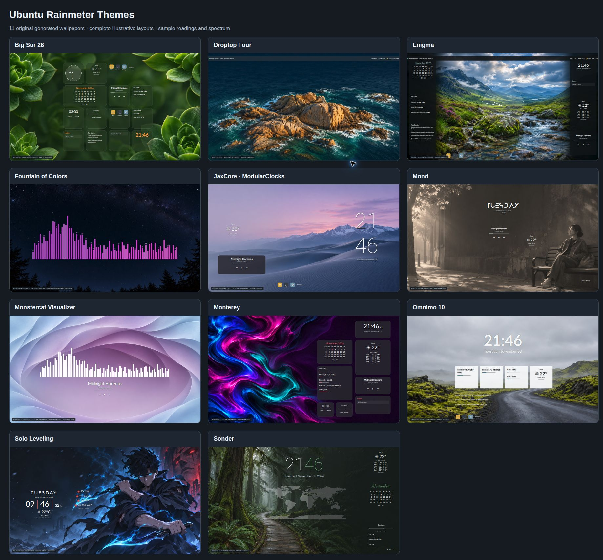

# Ubuntu Rainmeter Themes

Rainmeter-style layouts for **Ubuntu GNOME**: original wallpapers, live desktop widgets, application launchers and audio visualizers. Choose a theme by its folder name.



*Illustrative previews generated from theme settings. Readings and spectrum frames are examples; installed widgets use live data. These are independent Ubuntu adaptations of selected reference compositions, with original generated wallpapers. See each theme's documented differences from its Windows reference.*

## Install

Run from a Terminal inside your Ubuntu GNOME desktop, **without sudo**:

```bash
git clone https://github.com/gaur-adi/ubuntu-rainmeter-themes.git
cd ubuntu-rainmeter-themes
./install.sh solo-leveling --auto-location --install-deps
```

Pick another theme by its folder name:

```bash
./install.sh monterey --auto-location --install-deps
./install.sh mond --auto-location --install-deps
./install.sh fountain-of-colors --install-deps
```

`--install-deps` allows `sudo apt` to install missing Ubuntu dependencies. It does not install or replace GPU drivers. **Log out and sign in once after the first installation of either widget engine, or after a native-engine code update.** Later theme switches reload their configuration live.

## Theme gallery

Click a theme for its full preview, source references, included composition and limitations.

| Folder / theme | Composition |
| --- | --- |
| [solo-leveling](themes/solo-leveling/) | Sung Jin-Woo, day/date/time, weather and CPU/GPU/RAM readings |
| [mond](themes/mond/) | Anurati day heading, date/time, weather, player and trash |
| [sonder](themes/sonder/) | Thin clock, world map, forecast, calendar and meters |
| [droptop-four](themes/droptop-four/) | Menu bar, installed-apps dropdown, Files/Settings/Search and status |
| [jaxcore](themes/jaxcore/) | Selected ModularClocks/ModularPlayers-style composition |
| [monterey](themes/monterey/) | Right-hand dark dashboard with weather, meters, timer, notes and player |
| [big-sur](themes/big-sur/) | Big Sur 26-style translucent card grid and app shortcuts |
| [omnimo](themes/omnimo/) | Large clock, white information tiles, news and shortcuts |
| [enigma](themes/enigma/) | Information sidebars, analog clock, weather, notes, media and launchers |
| [monstercat](themes/monstercat/) | Real white audio spectrum with MPRIS track information and controls |
| [fountain-of-colors](themes/fountain-of-colors/) | Real 80-bin colored audio spectrum with fading peaks |

All **eleven original AI-generated wallpapers are bundled** in their respective theme folders. Installation does not require an image-generation account or wallpaper service. [Wallpaper prompts](docs/wallpaper-prompts.md) · [2026 reference research](docs/2026-research.md).

## Requirements and validation

| Component | Compatibility |
| --- | --- |
| Desktop | Ubuntu GNOME, including Wayland; not KDE/XFCE |
| Solo Leveling | Desktop Widgets extension; GNOME 45–51 as declared by its pinned release |
| Ten new themes | Native extension targeting GNOME 46–50, covering Ubuntu 24.04–26.04-era desktops |
| Validation environment | Ubuntu 26.04 / GNOME 50.1; other GNOME versions are compatibility targets, not independently tested machines |
| CPU / RAM / disk / network | Linux system readings without root |
| NVIDIA | Working driver and `nvidia-smi` |
| AMD | Best effort using readable sysfs utilization, VRAM and temperature files |
| Other / unsupported GPU | Explicit unavailable status; CPU/RAM still work |
| Media | MPRIS-compatible desktop player; browser playback requires MPRIS support in the browser |
| Audio visualizers | CAVA with PulseAudio or PipeWire's PulseAudio compatibility service |
| Volume controls | `wpctl` / WirePlumber |

**Native engine validation:** automated syntax/schema/installer checks, live collectors, a real 80-bin CAVA output check and Chrome-rendered previews. First-login Shell interaction, app launching, sliders and desktop layering require a manual smoke test before the new engine is merged/released. HTML previews are not actual GNOME Shell screenshots. Native widgets use translucent fills; the Windows suites' blur plug-ins and complete OS/framework features are not cloned.

The native engine rebuilds widgets when displays are connected, removed or rearranged, scaling from a 1920×1080 design canvas. On Solo Leveling's existing Desktop Widgets engine, rerun installation after display changes. Portrait and unusual display layouts may need theme-position adjustments.

## Weather, news and privacy

```bash
# Approximate current city from your internet connection
./install.sh sonder --auto-location

# A chosen city without IP geolocation
./install.sh sonder --city "Agra"

# Weather off
./install.sh sonder

# Override the background or public news feed
./install.sh enigma --wallpaper /path/to/wallpaper.jpg \
  --rss-url https://feeds.bbci.co.uk/news/rss.xml
```

Automatic weather sends your public connection IP to [ipwho.is](https://ipwhois.io/documentation), then uses approximate city coordinates with [Open-Meteo](https://open-meteo.com/). VPNs can change the detected city. The cache stores city/coordinates rather than the full IP response. Weather refreshes every 15 minutes; location approximately hourly. Offline weather is marked cached and expires after six hours.

News themes default to BBC's public RSS feed. CPU/GPU readings, notes and media metadata stay local. CAVA reads the **default system playback monitor**, not the microphone; audio is not recorded. Notes are stored locally. Fonts used by Mond/Sonder download from attributed, checksum-pinned sources on first installation.

## Manage and undo

```bash
./install.sh --list
./install.sh monterey --auto-location --dry-run
./uninstall.sh
```

The first managed install saves a wallpaper/settings backup under `~/.local/share/ubuntu-rainmeter-themes/`. Theme switching preserves that original backup. Uninstall removes managed widgets and restores the original wallpaper if a managed wallpaper is still selected. A background selected afterward is preserved.

Other Desktop Widgets entries and unrelated extensions are preserved. Shared extensions, dependencies, wallpapers, notes and backups stay on disk. Runtime data/cache locations respect `XDG_DATA_HOME` and `XDG_CACHE_HOME`.

Change sizes, positions, colors and modules in a theme's `theme.json`, then rerun its install command. Native theme layouts are data-driven; they do not accept arbitrary shell commands. Solo Leveling can also be adjusted using:

```bash
gnome-extensions prefs azclock@azclock.gitlab.com
```

## Add a theme or contribute

Each theme has `theme.json`, `wallpaper.png`, `preview.png` and a README under `themes/THEME-NAME/`. New native themes use normalized widget positions with canvas-based sizes; see an existing theme for examples.

[Fork → branch → pull request → tests → maintainer review](CONTRIBUTING.md). `main` is protected and contributions require approval from **@gaur-adi**.

## Development

```bash
/usr/bin/python3 -m unittest discover -s tests -v

GSETTINGS_BACKEND=memory \
URT_TEST_EXTENSION="$HOME/.local/share/gnome-shell/extensions/azclock@azclock.gitlab.com" \
/usr/bin/python3 -m unittest discover -s tests -v
```

Never run settings tests against your real dconf database. Integration tests explicitly require the in-memory backend and replace external extension/dconf mutations with test doubles. CI also validates the native JavaScript using GJS's parser.

## Credits and license

Original code: [MIT](LICENSE). Original generated wallpapers: [asset terms](LICENSE-ASSETS.md). Reference theme names belong to their respective creators; this project is not affiliated with them. [Credits and third-party licensing](CREDITS.md).
