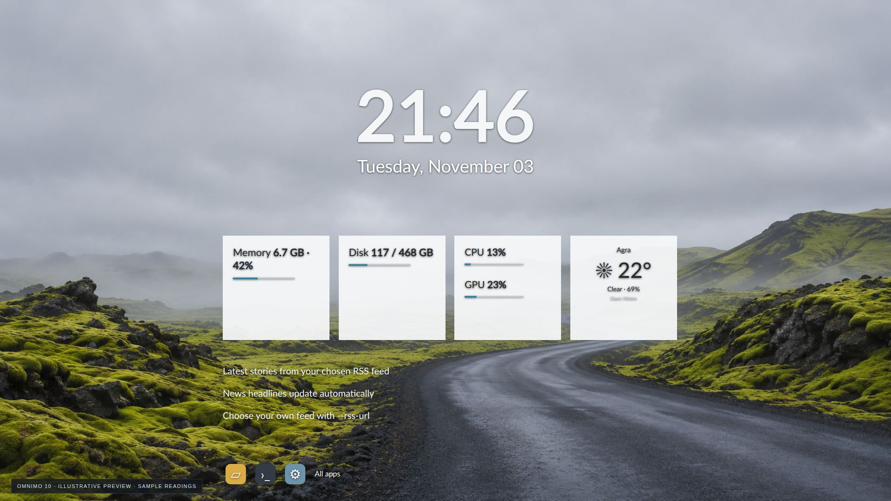

# Omnimo 10



*Reference-based Ubuntu adaptation with an original generated wallpaper. Preview values are examples; installed widgets use live readings.*

```bash
./install.sh omnimo --auto-location --install-deps
```

Original design: **fediaFedia / Omnimo contributors**. [Creator/source](https://github.com/fediaFedia/Omnimo) · [Reference preview](https://visualskins.com/skin/omnimo-10)

## Included composition and differences

- Combines the large clock/date composition with the reference’s white hardware tiles, weather, headlines and application shortcuts.
- This is a selected composition of Omnimo modules, not the complete hundreds-panel library, Microsoft-account integration or Windows-specific settings.

All eleven wallpapers are bundled locally. No wallpaper API or image-generation account is required to install. [Generation prompts](../../docs/wallpaper-prompts.md).

The native engine targets GNOME 46–50; collectors and the CAVA pipeline were tested on Ubuntu 26.04 / GNOME 50. Native Shell interaction needs a first-login smoke test before merging. First installation requires one logout/login. Existing Solo Leveling continues to support the wider Desktop Widgets compatibility range.

Use `--city "Your city"` for weather without IP lookup, `--wallpaper /path/to/image.jpg` for your own background, or omit weather flags to disable weather. For news widgets, `--rss-url https://example.com/feed.xml` overrides the default BBC feed.

Audio visualizers capture the default system playback monitor via CAVA; no audio is recorded. Media controls require a running MPRIS-compatible player. Unsupported GPU readings are labeled unavailable.

Undo: `./uninstall.sh`. Other user widgets, notes, backups and shared packages are preserved.
