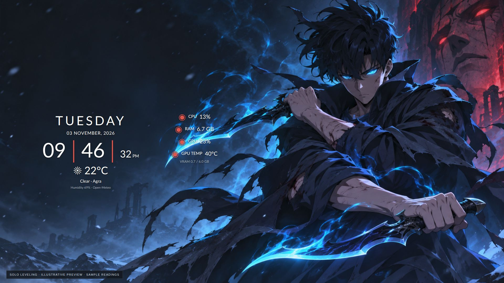

# Solo Leveling



*Illustrative preview with an original generated wallpaper. The installed clock, weather and system readings update live.*

```bash
./install.sh solo-leveling --auto-location --install-deps
```

Includes day/date/time, weather, CPU usage, RAM, GPU utilization, GPU temperature and VRAM on all connected displays. GPU readings depend on the installed driver and available hardware interfaces. The ring symbols are decorative; their numeric readings are live.

The Sung Jin-Woo wallpaper is newly generated for this repository and bundled as `wallpaper.png`. [Prompt](../../docs/wallpaper-prompts.md#solo-leveling) · [asset terms](../../LICENSE-ASSETS.md). Character rights remain with their respective owners.

This theme uses the existing Desktop Widgets engine. Log out/in once after the extension's first installation. Rerun installation after changing display topology. Adjust manually with:

```bash
gnome-extensions prefs azclock@azclock.gitlab.com
```

Use `--city "Your city"` for weather without IP lookup, or omit weather flags to keep it off. Undo with `./uninstall.sh`.
